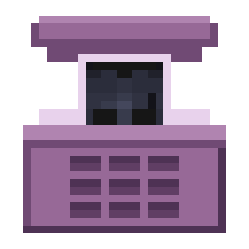

<p align="center"></p>

# Shulker Tooltip

A client-side native mod for [Sunrise](https://github.com/sunrise-org/sunrise), the Minecraft Java 26.3 rewrite in Rust.

Hover over a shulker box and hold **Left Ctrl** to see what's inside: a 9×3 grid of its contents, right in the tooltip.

## Features

- **9×3 contents grid** in the tooltip, laid out exactly like the box itself.
- **Only when you want it:** the grid appears while the key is held. Otherwise the tooltip stays vanilla.
- **Clean tooltip:** while the grid is shown, the long item list disappears and only the box name stays.
- **Colour-matched:** the slots are tinted in the colour of the shulker box, and the tooltip border uses a lighter shade of the same colour.
- **Configurable key:**
  - Set the key in *Options → Controls*.
  - Or pick Ctrl, Shift, Alt or *Always* on the mod's Config page in the mod menu.
- English and German translations.

## Install

1. Download `shulker_tooltip.smod` from the [Releases](../../releases) page.
2. Put it in your Sunrise game folder under `sunrise-native-mods/`. On Linux that is `~/.local/share/sunrise/game/sunrise-native-mods/`.
3. Start Sunrise and make sure the mod is enabled in the mod menu.

## Build from source

You need Rust and the Sunrise mod tool (`cargo sunrise-mod`).

```sh
cargo sunrise-mod check
cargo test
cargo sunrise-mod build
```

The packaged mod ends up in `target/sunrise-mod/shulker_tooltip.smod`. The mod is pinned to the Sunrise build in `sunrise-mod.toml` (`[native]`).

## How it works

A shulker box keeps its contents in the `minecraft:container` item component, a list of `{slot, item}` entries. The mod registers an item part for the `minecraft:shulker_boxes` tag and does three things:
- It draws the grid as a tooltip component.
- It shortens the text lines to just the name.
- It recolours the tooltip background and border.

## License

[MIT](LICENSE)
